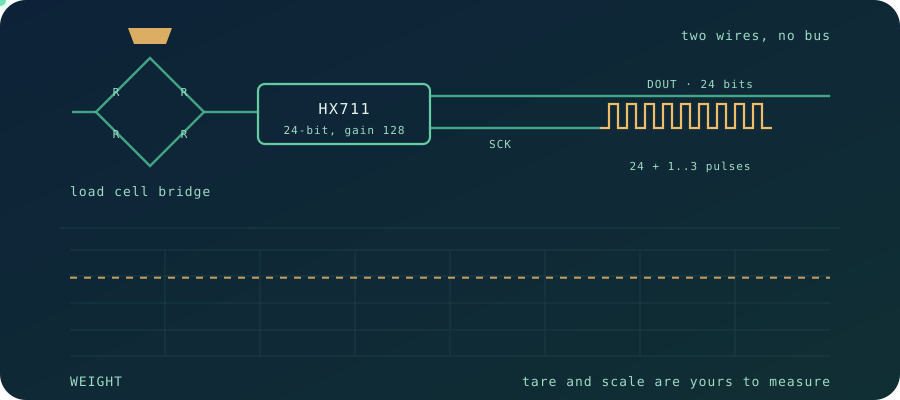

# mcu-loadcell

Turn a load cell into a scale with an HX711 (two GPIO pins) or NAU7802 (I2C). Both support taring an empty scale and calibrating it with a known mass.

**Platforms** · ESP-IDF 5.2+ and STM32 HAL. Hardware testing is pending. The host tests use simulated devices.

## Contents

- [Quick start](#quick-start)
- [Drivers and examples](#drivers-and-examples)
- [Using the library in your project](#using-the-library-in-your-project)
- [License](#license)

## Quick start

Connect the bridge to the HX711 and set the data and clock pins. Set `KNOWN_WEIGHT` to the value of your calibration mass in the units you want to read.

In a terminal with ESP-IDF activated, get the example and select the target for an ESP32. Change the target if your board uses another ESP32 chip.

```sh
git clone https://github.com/JonasAtelier/mcu-loadcell.git loadcell
cd loadcell/examples/esp/hx711
idf.py set-target esp32
```

Check the [wiring guide](docs/hardware.md) and edit the settings in [main.c](examples/esp/hx711/main/main.c) to match your board. Connect the board by USB, then build, upload and open the serial monitor.

```sh
idf.py build flash monitor
```

Start with the scale empty, then add the known mass when prompted. Copy the printed offset and scale into the example and clear `CALIBRATE` for subsequent runs. The library keeps calibration in RAM.

## Drivers and examples

After configuring either converter, call `loadcell_tare()` with the scale empty and `loadcell_calibrate()` with a known mass. Use the same unit for calibration and weighing. [Shared calibration and reading API](include/loadcell.h)

| Chip | Driver header | ESP-IDF project | STM32 HAL example |
|---|---|---|---|
| [HX711](docs/chips.md#hx711) | [hx711.h](include/hx711.h) | [Scale over data and clock pins](examples/esp/hx711/) | [Scale over data and clock pins](examples/stm/hx711/main.c) |
| [NAU7802](docs/chips.md#nau7802) | [nau7802.h](include/nau7802.h) | [I2C scale](examples/esp/nau7802/) | [I2C scale](examples/stm/nau7802/main.c) |

## Using the library in your project

- Add the component and enable the driver for your hardware. [Installation and build options](docs/installation.md)
- Open the ESP-IDF project for your hardware, or copy the STM32 example into a project with board setup already in place. [All ESP-IDF examples](examples/esp/) · [All STM32 examples](examples/stm/)
- Look up calls and chip-specific settings. [API usage](docs/usage.md) · [Hardware reference](docs/chips.md)

To run the simulated tests on your computer, run `make -C test test` from the library root. [Test requirements and coverage](docs/development.md)

## License

[MIT](LICENSE)

<p align="center">
  
</p>

[Browse the workshop catalog · ESP32 and STM32 drivers](https://github.com/JonasAtelier/jonas-atelier-libraries#esp32-and-stm32-drivers)
