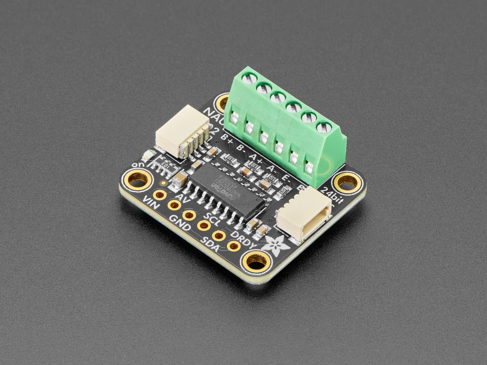

# Hardware wiring

[Back to README](../README.md)

Paths mentioned in this guide are relative to the repository root.

## Pins

On ESP-IDF any GPIO works; the GPIO numbers below are the ones the examples
in `examples/esp/` use. On STM32 the pins are the app's: the snippets in
`examples/stm/` take the I2C handle and the HX711's two pins as CubeMX
generates them.

### HX711 — `examples/*/hx711`

Two sides to wire: the module to the MCU, and the load cell's bridge to the
module.

| pin | goes to | note |
|---|---|---|
| VCC | 3.3 V or 5 V | the analog supply (`VSUP` on the chip); more headroom means more excitation for the bridge |
| VDD | 3.3 V | the digital supply, and it alone sets the logic level of DT and SCK. Many boards tie it to VCC — then run both at 3.3 V |
| GND | MCU GND | shared ground, always |
| DT (`DOUT`) | GPIO 16 | the chip drives this; the driver only reads it. On STM32 an input |
| SCK (`PD_SCK`) | GPIO 17 | the driver drives this, and the number of pulses is the protocol. On STM32 a push-pull output, low |
| RATE | tied low on most boards | low is 10 conversions a second, high is 80 (Table 1, p.2). The driver blocks either way |
| E+ / E− | the bridge's excitation | red and black on the usual four-wire cell |
| A+ / A− | the bridge's output | white and green. Channel A, gain 128 or 64 |
| B+ / B− | a second cell's output | channel B, gain 32 only. Leave open if unused |

Names on the left are the silkscreen of the common green HX711 breakout,
with Avia's names for the two signal pins in brackets (Table 1, p.2,
`docs/hx711.pdf`). The bridge wire colours are a convention rather than a
standard — meter yours.

The clock line is timing-critical in one direction only: held high for more
than 60 µs, the chip powers down (Fig. 3, p.5). The driver keeps each high
phase near 1 µs with interrupts masked. Do not put a filter capacitor on
SCK, and keep DT's trace short: the driver samples DT a microsecond after
each falling edge.

### NAU7802 — `examples/*/nau7802`

| pin | goes to | note |
|---|---|---|
| DVDD | 3.3 V | digital supply, 2.7–5.5 V |
| AVDD/LDO | REFP, and 0.1 µF to AVSS | the internal LDO's output when `use_internal_ldo` is set; feed it 2.7–5.5 V yourself if it is not |
| AVSS, DVSS | GND | shared ground, always |
| SDIO | GPIO 21 | I2C data, SDA on every breakout. Pull-up required |
| SCLK | GPIO 22 | I2C clock, SCL on every breakout. Pull-up required |
| DRDY | not used by this driver; leave open | readiness is polled over I2C instead |
| REFP | the cell's positive excitation | tied to AVDD/LDO: reference and excitation are the same rail, which is what makes the reading ratiometric |
| REFN | the cell's negative excitation | tied to AVSS |
| VIN1P, VIN1N | the cell's signal pair | channel 1, the default |
| VIN2P, VIN2N | a second cell, or open | channel 2, selected with `nau7802_set_channel()` |

Names are the datasheet's, from `docs/nau7802.pdf` section 6, and the
excitation wiring is its 16-pin application circuit in section 9.4. The I2C
address is fixed at 0x2A with no strap pin (p.15), so one of these per bus.

  
   Adafruit NAU7802 breakout &mdash; photo <a href="https://www.adafruit.com/product/4538">Adafruit Industries</a>

